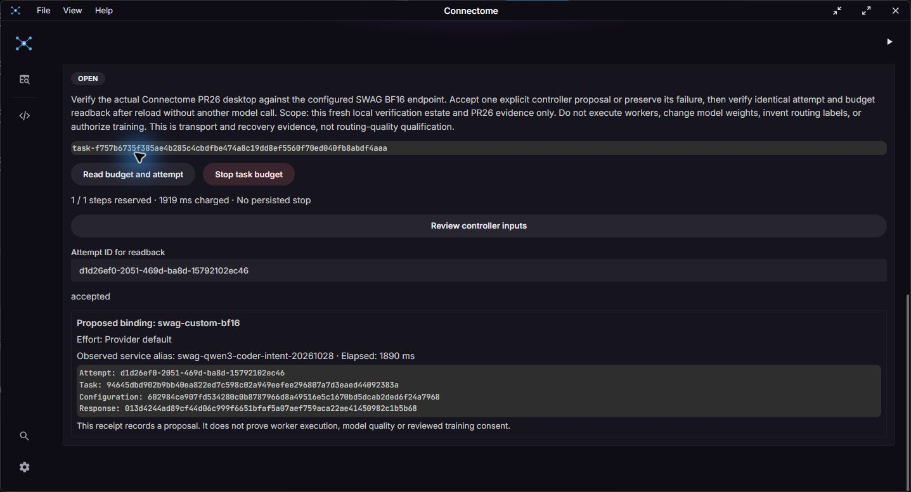
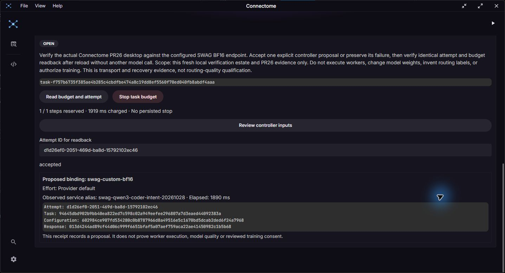

# Live controller desktop trial

Date: 2026-10-30. This is actual development integration evidence for draft PR26,
not model qualification, worker execution or a public release.

## Source and setup

The same preview binary used in the earlier desktop trial ran unchanged:
Connectome implementation `d7eb6ea3027b76e1afd515715ab4958e66083060`, engine
`61ddb26416811ba7e56edf2e28b8cef3acad5930`. See the retained
[build receipt](evidence/controller-desktop-20261030/build-receipt.json).

An operator helper installed a fresh estate and started the engine with its
explicit credential mapping. It applied the existing experimental SWAG profile
through configuration preview/apply and closed its setup session. Setup performed
no inference. Authenticated endpoint discovery returned 200 and the configured
service alias. Connectome's existing **Connect instance** flow verified the
expected instance and used the installed operator credential file through native
code. No provider secret entered the renderer or published evidence.

This is the operator-managed server path. The one-click local engine launcher
still does not configure a provider credential mapping. The profile allows
unverified service identity and contains one candidate; discovery of an alias
does not attest the model's weights or establish multi-model routing quality.

## Actual desktop action and result

The desktop recorded the real maintenance task **Verify Connectome PR26 live
BF16 proposal and recovery** with scope limited to this estate and PR26 evidence.
The acceptance criterion was one explicit proposal or a preserved failure,
followed by reload/readback without another model call. Limits were one step,
60,000 ms per step and 900,000 ms total. No worker, training or model modification
was authorized by the task.

After reviewing the controller/candidate and task/configuration digests, one
click requested one experimental proposal. The engine accepted attempt
`d1d26ef0-2051-469d-ba8d-15792102ec46` for task
`task-f757b6735f385ae4b285c4cbdfbe474a8c19dd8ef5560f70ed040fb8abdf4aaa`.
Its receipt reports HTTP 200, `swag-custom-bf16`, provider-default effort,
1,017 input tokens, 20 output tokens, and 1,890 ms adapter elapsed time.
Budget readback showed one reserved step, 1,919 ms charged, no active attempt
and no uncertain execution. These are observed counters, not latency benchmarks.

An actual webview reload cleared the displayed result. **Recover last attempt**
restored only task/attempt coordinates and required readback. **Read budget and
attempt** returned the same accepted receipt and spent budget. Independent public
engine reads taken after reload, before and after UI recovery, have identical
task, budget and attempt payloads. No second proposal was requested.

The app was closed and its externally started, identity-checked trial engine
was stopped. Subsequent quick verification passed all 13 checks with runtime
cursor 8, control journal sequence 181 and current source attunement. This does
not establish graceful server shutdown or desktop recovery across engine restart.

## Receipts and retained limitations

[Receipt directory](evidence/controller-desktop-20261030) contains both public
readback sets, build identity, post-close verification and a SHA256 manifest.
Published JSON was whitespace-formatted to repository style; the manifest binds
original and published bytes, and export validation checked parsed equality.
Session creation responses and credentials are excluded. Local original receipts,
UI text, setup/readback helpers and the estate remain under
`D:/projects/swag/.swag/controller-ui/live-bf16-20261030/`.

The first auxiliary `task-read` request omitted required `max_storage_keys` and
returned HTTP 400. Its setup session was closed; the failure's raw body was not
retained. The helper was corrected to the same 10,000-key bound used by the native
client and now preserves HTTP error bodies. Thus no independent pre-reload JSON
receipt exists; pre-reload evidence is the actual UI observation/screenshot.
The corrected read-only requests did not dispatch or retry inference.
One navigation click lacked geometry; observation was refreshed. A later Tasks
click did not navigate; the visible tab was then selected from a fresh screenshot.
Neither failure dispatched inference.

Worker execution, ordinary-edit successor planning, correlated RROFLOW delivery,
independently reviewed outcomes, checkpoint qualification, installer/container
delivery and protected dependency landing remain required. No training record,
evaluation label or owner review consent was created by this trial.
