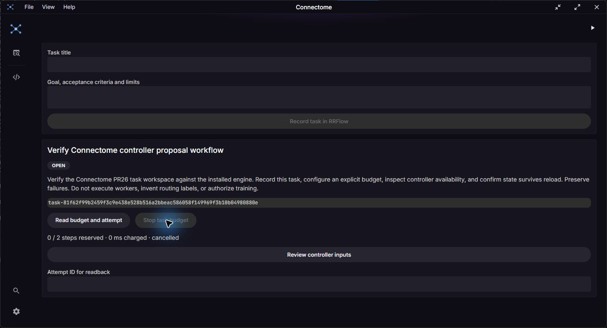

# Controller proposal integration evidence

Date: 2026-10-30. Connectome PR26 remains draft behind engine PR222 and its
unmerged prerequisites. This report does not qualify a public release or model.

## Implemented boundary

The task workspace calls the native `rrd_task` bridge. The bridge derives scope,
uses validated public Rust contracts, projects bounded views, and sends mutations
once. The provider timeout comes from the installed controller binding; session
leases must cover it. Readback and Stop share the lease rather than waiting for
an exclusive inference lock. A local preflight failure is `not_dispatched`;
failure after entering the proposal transport remains uncertain until readback.

Both SDKs pin `61ddb26416811ba7e56edf2e28b8cef3acad5930`. The real engine was
built from that clean public source using `cargo build --locked -p rrflow-cli
--bin rrflow`. Staged Windows sidecar: 167,331,328 bytes, SHA256
`bea59498eaee2c80312a365370abd6109e91188705914c826eb06d0e1fa85748`.
It is a development build, not an installer or clean-machine qualification.

## Checks performed

- Locked dependency installation passed; only the two Rust contract packages
  and the TypeScript SDK resolution changed.
- `pnpm check` passed: Biome 423 files, no errors/warnings; identity/isolation,
  63 API examples, 18 value-model checks, dependency/version authority and tsc.
- `pnpm build` passed. Existing vendor WASM resolution/externalization,
  mixed-import and large-chunk warnings remain; this is not size optimization.
- Existing browser smoke suite: four passed. It uses transport mocks and proves
  rendering/navigation only, not native task dispatch. No new simulated model
  response was introduced.
- Native ordinary suite: 39 passed, 16 explicitly ignored process cases.
- All 16 process cases passed against the exact staged engine, including the
  new maintenance task controls, no configured endpoint → no dispatched attempt,
  Stop while a long shared lease is held, and identical budget after reconnect.
  The new case passed again after adding post-renewal lease-duration validation.
- The engine-value golden was regenerated by writing/reading values through this
  actual pinned engine. It was not relabelled from the older revision.
- Strict all-target Clippy, format and whitespace checks passed during development.

## Failures retained

The first Rust check used `to_string` on `CorrelationId`, which has no Display
implementation; corrected to the public `as_str` accessor. The first golden and
task process runs used Cargo's hard-linked debug executable and failed native
file admission (`expected=1 observed=2`). `fsutil hardlink list` confirmed Cargo's
debug/deps pair. The staged sidecar is an independent single-link copy with the
same hash; using that artifact passed without weakening engine admission.
The frontend authority check correctly failed while the golden still named the
old engine. It passed after actual regeneration. Formatter/whitespace checks
caught Windows newline conversion; modified text was restored to repository LF.

## Native desktop trial

The subsequent Windows desktop trial used actual Connectome implementation
`d7eb6ea3027b76e1afd515715ab4958e66083060` and the staged engine above. The
preview executable is 47,428,608 bytes, SHA256
`a0169dfe698d2112eb6c7deae2fb77ff37b303b556da3712a9f3ca84902bb937`.
The production frontend and debug native app built with
`pnpm tauri build --debug --no-bundle --config src-tauri/tauri.bundle.conf.json`
and `VITE_CONNECTOME_PREVIEW=true`. No installer was built.

The desktop installed a fresh local estate, opened its native session, and
recorded the actual maintenance task "Verify Connectome controller proposal
workflow". Task identity:
`task-81f62f99b2459f3c9e438e528b516a2bbeac586058f149969f3b10b04980880e`.
Explicit limits were two steps, 60,000 ms per step and 900,000 ms total. Review
showed the missing endpoint profile and disabled proposal dispatch. After an
actual webview reload, manual reads returned the same task and budget. Stop
returned cancelled with zero reserved steps and zero charged time.

The first attempted click on Record task was outside the window and did not
submit. Scrolling and observing the visible control preceded the successful
submission. Closing the app ended its owned app/engine processes. Subsequent
`rrflow --json verify --project <trial-estate> --level quick` returned exit 0,
13 passing checks, runtime cursor 7, control journal sequence 95 and current
attunement source. This is not proof of graceful shutdown protocol. The estate,
build receipt and observed UI text remain in the local trial directory
`D:/projects/swag/.swag/controller-ui/d7eb6ea3/`. Final strict all-target Clippy
also passed after the post-renewal lease guard.

## Remaining evidence

The native desktop control journey above passed. A subsequent
[live desktop trial](controller-desktop-live-trial.md) also passed one configured
BF16 proposal and reload/readback, with its explicit limits and failures retained.
The latest-attempt bookmark is local recovery metadata only; older
attempts require their recorded IDs. No training labels, dataset admission or
review consent were produced. This slice provides no worker execution, ordinary
source-edit successor plan, RROFLOW delivery, automated learning, quantization,
public installer signing or container deployment. Required CI and protected
dependency landing must precede integration/release claims.
