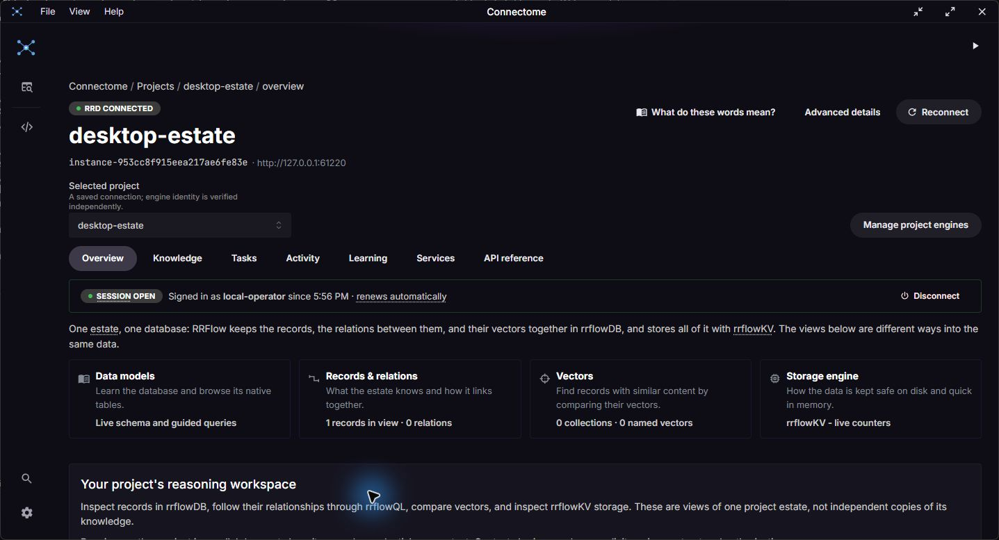
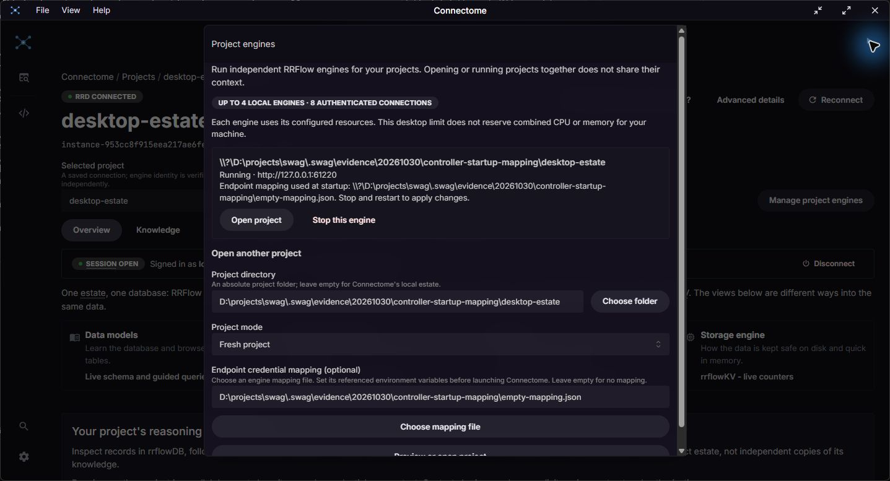

# Endpoint credentials in desktop-owned project startup

This package follows sprint 015 and parking lot 005, based on controller UI
revision `ed6ed0e59d68fe310bf2b719fd721eee167a1c10`. The SDK/engine pin remains
`c376e27126c0fd513f8ffeb1e8e17a8befe87602`. It closes a launcher configuration
gap; complete worker execution and public release remain open.

## Behavior

In **Manage project engines**, select a project and optionally choose its engine
endpoint credential mapping file. The file must be an absolute regular-file
path. Supply its referenced environment variables before launching Connectome.
Only the engine reads the mapping and resolves credentials; the renderer receives
paths, never file contents or credential values. No provider/model choice or
endpoint profile is created by selecting a mapping.

The selection is local to this start, is shown alongside an installation preview,
and clears when the project selection changes. It is not saved as a global
default or copied into project files. Running engines show the resolved path
used at startup. Stop and restart to apply mapping or environment changes:
requesting a configured start against an already-owned process is refused,
including removing or adding a mapping. Opening the running project remains
available. Ordinary project source edits are outside this startup setting and
do not invoke this guard.

## Verification on Windows, 2026-10-30

- Native absolute/missing/directory/path-with-spaces check passed.
- Actual-engine startup case passed: empty mapping accepted; repeated configured
  start refused; malformed mapping rejected by RRFlow; failed-start reservation
  released; corrected file reopened the same instance; mapping-free startup and
  refusal to silently add credentials to a running child verified.
- `cargo test --locked --manifest-path src-tauri/Cargo.toml`: 40 passed,
  17 process/helper cases intentionally ignored. Full ignored process selection
  reported 17 passed: 16 actual process cases and one inactive visual-capture
  helper. Its capture environment variables were absent. No model/worker call,
  synthetic training data, invented credential or claimed provider result.
- Strict all-target Clippy and Rust format passed. Full `pnpm check` passed,
  including 432 Biome files, 71 API examples, 18 value-model checks and TypeScript.
- Production frontend build passed. Initial browser smoke: three passed, one
  failed before application startup. Its retained trace records
  `net::ERR_NO_BUFFER_SPACE` fetching the messaging JavaScript asset; screenshot
  is blank and the static HTML title never changed. A single serialized run
  after native jobs ended passed all four cases with retries disabled and no
  existing-server reuse. This is bounded characterization, not a root-cause fix.
  These existing browser tests use mocked transport and do not render the native
  project launcher or prove controller dispatch.

The actual engine executable was independently hash-checked against the retained
sidecar manifest: 150,713,344 bytes, SHA256
`bf1f17f116246dacb4ee55c46484698b57f3184bfffe38c2d0b7d7d4207e8848`.
Local command logs/results and the initial browser trace/screenshot/video are
retained under `controller-startup-mapping` in the operator's evidence directory
for this date. Windows default text decoding initially changed four punctuation
strings; diff review restored their original UTF-8 bytes, then the native suite,
focused real-process test and strict lint/format passed again. No unrelated
imports, dependencies, SDK pins or model data changed.

Build warnings remain: vendor WASM runtime resolution/browser externalization,
mixed imports and large chunks. The previously recorded CodeMirror peer mismatch
remains unresolved; no dependency update or false-positive claim is made here.
The browser resource failure remains retained and requires attention if it recurs.
No clean-machine, model quality, secret-store onboarding, container or release
qualification is claimed by these component tests.

## Actual desktop verification

Clean build source: `6de73eec58be5cea4cdae42fea6001772006ee3a`.
`VITE_CONNECTOME_PREVIEW=true CARGO_PROFILE_DEV_DEBUG=0 CARGO_BUILD_JOBS=2`
with `pnpm tauri build --debug --no-bundle --config src-tauri/tauri.bundle.conf.json`
completed successfully in 50.98 seconds. The independently copied preview is
47,439,360 bytes, SHA256
`10561b6925931bee96148c92aa94c9b1ce35d1470c733967269c632bf0aba694`;
its adjacent engine is the exact c376e271 executable above.

The actual Windows app rendered the new controls. Entering a mapping and then
changing the project cleared the selection. The native file picker opened with
the JSON filter; its automation accessibility index was unavailable, so the
picker was cancelled and the visible path input was used. A first installation
button click was outside the viewport; scrolling exposed it and the subsequent
click installed the reviewed plan. Neither failed UI input is counted as an
accepted action. The selected file contained only a valid empty mapping; no
provider secret, endpoint profile, model request or training record was involved.

Through the UI, the trial installed a dedicated estate, started its own engine,
opened an authenticated session, displayed the selected startup mapping, stopped,
and reopened the same instance. OS process evidence binds the exact child
executable and `--endpoint-credentials` argument to the observed project. Both
authenticated `ready` checks passed; after each UI stop, all 13 quick verification
checks passed. Instance, plan, project inventory and runtime manifest identities
matched across reopen. The app and its owned trial processes were then closed;
an OS process query confirmed none remained at the trial artifact path. Existing
project data/profiles were preserved. The generated trial estate and credentials
remain private local evidence.

[Evidence manifest](evidence/controller-startup-mapping/manifest.json) binds the
build receipt, actual CLI outputs, process command line, test logs and unedited
desktop screenshots. Large/raw CRLF reports are losslessly compressed and bind
both byte hashes. Exported reports were checked against the generated operator
credential before publication. These are setup observations, not routing quality.

[CI run 41134260205](https://github.com/rrflow/connectome-development/actions/runs/41134260205)
passed for implementation revision `6de73eec`: frontend/render, native Windows,
macOS and Linux, real-engine SDK/process integration and ci-gate. Later evidence
commits must be checked at their own heads. PR27 remains stacked on draft PR26;
neither this run nor the desktop trial supplies the unmerged engine prerequisites.
